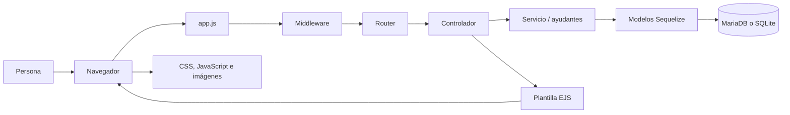

# Guía del código del Sistema Lonja

Esta guía explica qué hace la aplicación y cómo localizar la parte que una persona quiere comprender o modificar. Cada capítulo combina una explicación cotidiana con nombres de archivos y relaciones técnicas. Las rutas se escriben desde la raíz del proyecto.

## Cómo recorrerla

1. [Qué hace la aplicación](01-que-hace-la-aplicacion.md): producto, personas usuarias y límites.
2. [Controladores y servicios](02-controladores-y-servicios.md): cómo una acción HTTP se convierte en una operación del negocio.
3. [Ayudantes](03-ayudantes.md): reglas reutilizadas por distintos módulos.
4. [Plantillas](04-plantillas.md): páginas que el servidor presenta.
5. [Interfaz JavaScript y CSS](05-interfaz-js-css.md): comportamiento visual en el navegador.
6. [Recorridos completos](06-recorridos.md): ejemplos de compra, atención y comunidad.
7. [Inventario de código](07-inventario-archivos.md): dónde se encuentra cada grupo de archivos.
8. [Inventario de vistas](08-inventario-vistas.md): qué pantalla corresponde a cada plantilla.

## En una frase

La persona usa el navegador; `app.js` deriva la solicitud al router; el router la entrega al controlador; el controlador coordina servicios, ayudantes y modelos; Sequelize lee o escribe la base de datos; EJS genera la página y los archivos de `public/` le dan presentación e interacción.

Para operación, instalación, seguridad, base de datos y permisos, usa la [documentación de referencia](../README.md). Los pendientes operativos se conservan en archivos locales fuera de esta guía.
