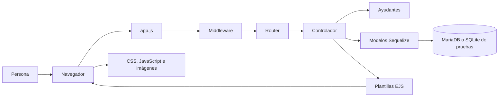

# Guía del código del Sistema Lonja

Esta guía describe la versión 1 de la aplicación. Está organizada como la guía de `main`, pero su contenido se basa en los archivos y funciones de esta rama. Cada capítulo explica el propósito en términos cotidianos y orienta a los archivos concretos para trabajar.

## Cómo recorrerla

1. [Qué hace la aplicación](01-que-hace-la-aplicacion.md): usuarios, capacidades y límites de v1.
2. [Controladores y servicios](02-controladores-y-servicios.md): cómo una solicitud web se convierte en una operación.
3. [Ayudantes](03-ayudantes.md): reglas compartidas por varios módulos.
4. [Plantillas](04-plantillas.md): páginas HTML generadas por el servidor.
5. [Interfaz JavaScript y CSS](05-interfaz-js-css.md): comportamiento y apariencia en el navegador.
6. [Recorridos completos](06-recorridos.md): cómo colaboran las capas en tareas reales.
7. [Inventario de archivos](07-inventario-archivos.md): mapa para encontrar el código.
8. [Inventario de vistas](08-inventario-vistas.md): correspondencia entre pantallas y archivos EJS.

La documentación de operación, rutas y base de datos está en el [índice de documentación](../README.md).

## En una frase

El navegador envía una solicitud a `app.js`; un router la dirige a un controlador; el controlador valida y coordina ayudantes y modelos; Sequelize lee o escribe MariaDB; EJS construye la respuesta y `public/` aporta estilos e interacción.

