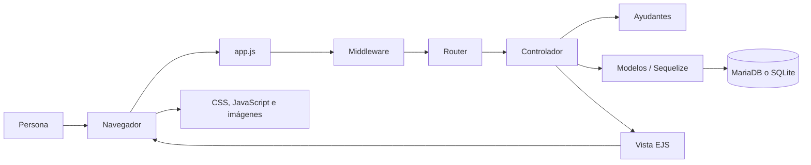

# Guía del código del Sistema Lonja

Esta guía está pensada para alguien que apenas conoce la lonja y para quien va a modificar la aplicación. Cada documento enumera los archivos de código de una parte, explica qué resuelve cada uno y señala con quién se comunica. Las rutas se escriben desde la raíz del proyecto.

## Cómo recorrerla

- Si solo necesitas entender el producto, empieza en [01 — Qué hace la aplicación](01-que-hace-la-aplicacion.md).
- Si vas a ejecutar o modificar una función, consulta [02 — Arranque y recorrido de una petición](02-arranque-y-peticion.md) y después la capa correspondiente.
- Si vas a tocar datos, empieza por [03 — Modelos y base de datos](03-modelos-y-datos.md).
- Para ampliar una ruta, usa [04 — Rutas y permisos](04-rutas-y-permisos.md) y [05 — Controladores](05-controladores.md).
- Para cambiar cómo se calcula algo, consulta [06 — Ayudantes](06-ayudantes.md).
- Para cambiar pantallas, consulta [07 — Plantillas EJS](07-plantillas.md) y [08 — CSS, JavaScript y recursos](08-interfaz.md).
- Para revisar comportamiento o crear datos de trabajo, usa [09 — Pruebas y datos demo](09-pruebas-y-demo.md).
- Para seguir los recorridos completos, consulta [10 — Cómo colaboran las partes](10-recorridos.md).
- La lista exhaustiva por archivo está en [11 — Inventario de archivos de código](11-inventario.md).
- Las pantallas EJS aparecen una por una en [12 — Inventario de vistas](12-inventario-vistas.md).

## En una frase

El comprador o el personal solicita una página; `app.js` decide qué router recibe la URL; el router escoge un controlador; el controlador aplica reglas usando ayudantes y modelos; Sequelize conversa con MariaDB o SQLite; finalmente EJS arma el HTML y los archivos de `public/` dan estilos e interacción.

Cada documento separa el lenguaje de negocio (“pedido”, “reserva”, “lote”) del detalle técnico y traduce los términos para lectores no técnicos.
